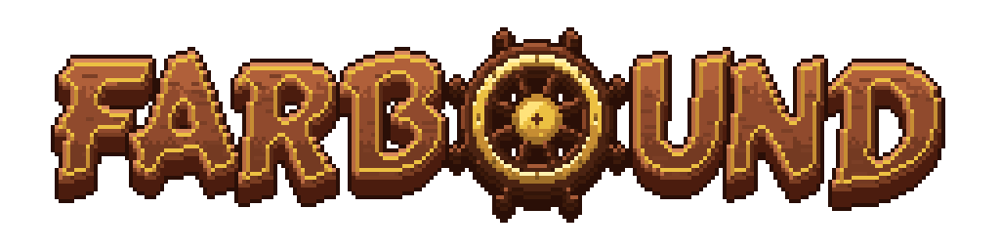

*Build your vessel. Chart the world. And always leave a light on at home.*

**[Download on Modrinth](https://modrinth.com/modpack/farbound)**  ·  **[Wiki](https://github.com/DefinitivTim/farbound/wiki)**  ·  **[Changelog](CHANGELOG.md)**  ·  **[Report a bug](https://github.com/DefinitivTim/farbound/issues/new/choose)**

*Deutsche Kurzfassung: [README.de.md](README.de.md)*

**Farbound** is a cozy engineering adventure for **Minecraft 1.21.1 on NeoForge**, built on **Create** and **Create: Aeronautics**. Build airships, boats and land vehicles, set out into a world worth crossing, and come home to a warm kitchen.

| | |
|---|---|
| ⚙️ **Build your vessel** | From your first wobbly balloon to steamships and crawlers for rough terrain. Built block by block, backed by a wide set of Create addons. |
| 🌍 **Explore at your own pace** | New biomes, old ruins, living oceans and realms beyond the map. Structure loot is instanced per player. |
| 🍞 **Come home hungry** | Farm, forage, bake, brew and cook, let Create take over the chopping, and furnish a home worth returning to. |
| 📜 **Quests that guide, not push** | A quest book from your first gear to the far edges of the world. A travel journal, not a checklist. |

## Quick start

1. Install the [Modrinth App](https://modrinth.com/app).
2. Search for **Farbound** and click **Install**, or open the [Modrinth page](https://modrinth.com/modpack/farbound).
3. Give the instance **8 GB of RAM** and launch. The first launch takes a while, that is normal.

Other launchers are covered in the [Installation guide](https://github.com/DefinitivTim/farbound/wiki/Installation).

**Good to know**
- **RAM:** 8 GB minimum. 12 GB if you enable Distant Horizons (optional, ships disabled).
- **Shaders:** optional. Create: Aeronautics vessels can show visual glitches with Iris shaders, see [Troubleshooting](https://github.com/DefinitivTim/farbound/wiki/Troubleshooting).
- **Updates:** back up your worlds before updating.

## Documentation

Everything lives in the [wiki](https://github.com/DefinitivTim/farbound/wiki):
[Installation](https://github.com/DefinitivTim/farbound/wiki/Installation) ·
[Getting Started](https://github.com/DefinitivTim/farbound/wiki/Getting-Started) ·
[Vehicles](https://github.com/DefinitivTim/farbound/wiki/Vehicles) ·
[Questlines](https://github.com/DefinitivTim/farbound/wiki/Questlines) ·
[Mod Overview](https://github.com/DefinitivTim/farbound/wiki/Mod-Overview) ·
[Performance and Settings](https://github.com/DefinitivTim/farbound/wiki/Performance-and-Settings) ·
[Multiplayer](https://github.com/DefinitivTim/farbound/wiki/Multiplayer) ·
[Troubleshooting](https://github.com/DefinitivTim/farbound/wiki/Troubleshooting) ·
[FAQ](https://github.com/DefinitivTim/farbound/wiki/FAQ)

## Bugs and suggestions

Use the [issue tracker](https://github.com/DefinitivTim/farbound/issues/new/choose). The templates ask for pack version, launcher, allocated RAM, whether Distant Horizons or shaders were active, and your `latest.log`. Please reproduce problems on an unmodified pack first.

Mod suggestions are welcome. A mod needs to fit the theme (vehicles, home or performance), run well with the rest of the pack and allow redistribution in a public modpack.

## This repository

Documentation, issue tracking and a few files the pack reads at runtime. The pack itself is distributed through Modrinth only.

| Path | Purpose |
|---|---|
| `fancy_menu/` | Texts for the in-game menu. Do not rename. |
| `changelogs/` | Version data for the in-game update checker |
| `CHANGELOG.md`, `CHANGELOG.de.md` | What changed in each version |
| `assets/` | Images and texts for this page and the pack |
| `license.md` | License of Farbound's own content |

## License

Farbound's own content (curation, configuration, custom scripts and original assets) is **All Rights Reserved**, © DefinitivTim. You may download and play the pack, including on multiplayer servers. You may not redistribute, mirror, fork or sell it. Every bundled mod keeps its own author's license. See [license.md](license.md) and the [License and Credits](https://github.com/DefinitivTim/farbound/wiki/License-and-Credits) page.

## Credits

Farbound stands on the work of hundreds of mod authors, above all the **Create**, **Create: Aeronautics** and **Sable** teams. The full list of included projects is on the [Modrinth page](https://modrinth.com/modpack/farbound). If you enjoy a mod, consider supporting its author.

*Your ship is not going to build itself. See you out there.*

